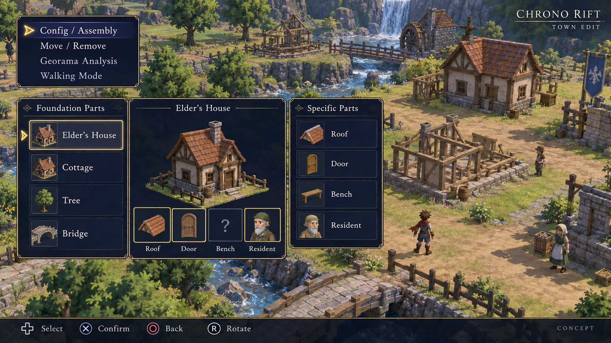
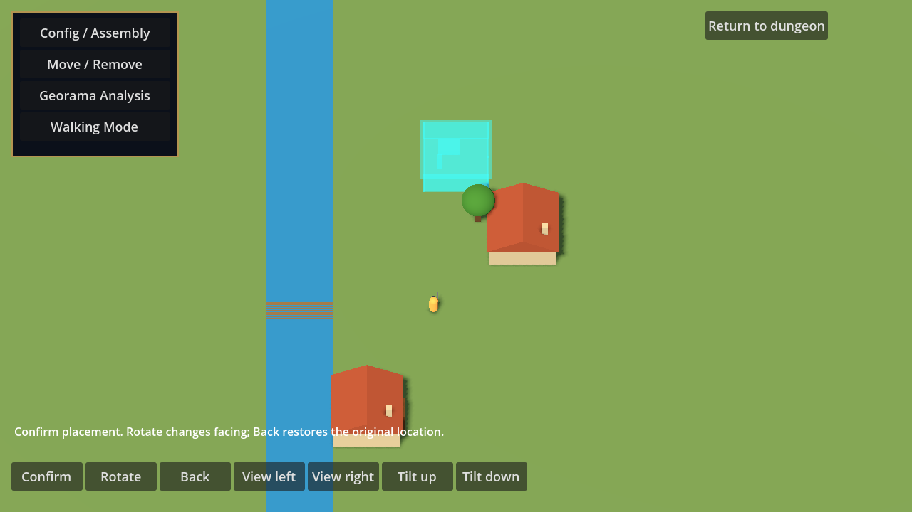
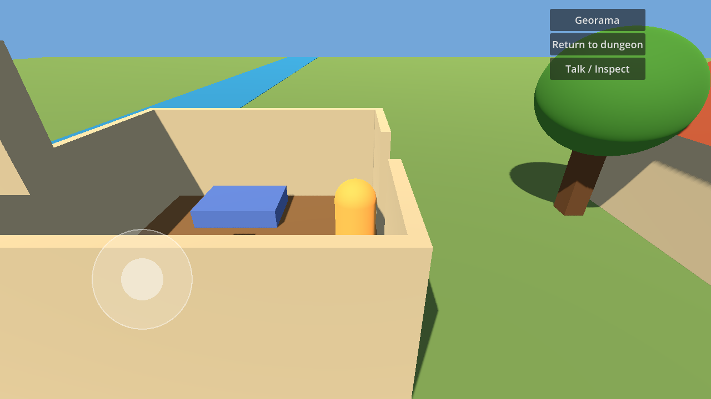

# Chrono Rift

An Android action-RPG with a recovered-parts town-restoration puzzle, targeting the first *Dark Cloud*'s gameplay, built with Godot 4.7.2. The full plan is in [`docs/WFBP.md`](docs/WFBP.md).

## Status

- [x] Phase 1: engine baseline, touch controls, melee combat
- [x] Phase 2: weapon durability, inventory and build-up
- [x] Phase 3: procedural dungeons and restoration-orb collection
- [x] Phase 4: Georama assembly, physical town and resident requests (prototype)
- [ ] Phase 5: Android export and CI

## Run

Open the folder in Godot 4.7.2 and press Play to explore a procedural dungeon.
`scenes/main.tscn` remains the test arena with two training dummies.

| Action  | Touch                   | Keyboard     |
|---------|-------------------------|--------------|
| Move    | Left side of the screen | WASD / arrows |
| Attack  | ATK                     | J / Space    |
| Dodge   | DODGE                   | K / Shift    |
| Lock-on | LOCK (hold)             | L / Tab (hold) |
| Camera  | —                       | Q / E        |

## Tests

The engine version is pinned in `.godot-version`. Use standard Godot 4.7.2
and PowerShell 7 (`pwsh`) to import and run every test:

```powershell
./tools/Test-Project.ps1 -GodotPath /path/to/Godot_v4.7.2-stable_win64_console.exe
```

Use the Linux Godot executable path on Linux. The runner applies import/test
timeouts, rejects engine/script errors and missing success markers, and saves
logs in `.godot/verification/`. CI uses the same runner and verifies the
downloaded engine checksum.

The tests cover scene loading, input, combo/dodge timing, physics hitbox damage,
accepted-hit reporting, death cancellation, dummy respawn collisions and
interrupted multitouch. Headless checks do not replace visual or Android device
testing.

## Android debug build (Windows)

The local toolchain uses standard Godot 4.7.2 and matching export templates,
OpenJDK 17, Android Platform 36 and Build-Tools 36.0.0. SDK/JDK installations,
editor settings and debug keys stay outside the repository.

```powershell
./tools/Build-Android.ps1
```

Defaults use the portable installations in the workspace's `work/` directory
and write `outputs/Chrono-Rift-debug.apk`. Supply `-GodotPath`, `-JavaSdkPath`,
`-AndroidSdkPath` and `-OutputPath` for another installation. The script requires
an initialized portable Godot editor, runs all tests, exports the APK and checks
its signature and 16 KB ZIP alignment. Debug signing is for testing only.

The `Android Debug` preset targets API 36, supports API 24+, and includes ARM64
for phones and x86_64 for the local emulator. It uses prebuilt templates, so
Gradle, NDK and CMake are not required for this debug build. Release AAB builds
will need separate Gradle and signing configuration.

Install and launch using the SDK's `platform-tools/adb.exe`:

```powershell
adb install -r /path/to/Chrono-Rift-debug.apk
adb shell am start -W -n com.chronorift.game/com.godot.game.GodotAppLauncher
```

Local verification used an API 36 x86_64 emulator with WHPX and host graphics.
SwiftShader hit a shader uniform limit; host graphics rendered the arena cleanly.
Physical ARM64 device testing and runtime testing on a 16 KB device remain pending.

## Weapon progression

`GameState.weapon_inventory` owns separate copies of weapon templates. The hero
starts with Battle Wrench. Accepted hits consume WHP; missed swings, duplicate
contacts and incoming damage do not. Battle Wrench survives a break and can be
repaired. Other weapons are lost by default; retained broken weapons deal 10%
attack (minimum 1) until repaired. Unequipping or losing a weapon cancels its swing.

Inventory APIs are `add_weapon`, `equip`, `remove_weapon`, `repair_weapon`, and
`build_up`. Repair currently accepts a durability amount; repair-item consumption
and save/load are not implemented. Element/slayer values travel with the damage
payload; resistance/bonus formulas and weapon experience/attachments are deferred.

Battle Wrench builds into Gladius at attack 20, Fire 5 and Beast 3. Build-up
replaces the owned instance, preserves trained attack/element/slayer values when
greater than the target defaults, and restores full target WHP. The evolved
weapon uses its own break policy, so starter protection does not carry forward.
Progression APIs and combat are implemented; inventory/HUD screens are future work.

`tests/test_weapon_matrix.gd` covers durability boundaries, ownership, signals,
break/removal, repair, build-up and combat integration. CI discovers it automatically.

## Procedural dungeon

`scenes/dungeon/dungeon_manager.tscn` starts a seeded 48×48 BSP dungeon. The
default run seed is 1337; change the manager's `dungeon_seed` to replay another
layout. Rooms connect through three-cell-wide orthogonal corridors. Stone-colored
primitive tiles use shared materials and batched meshes; merged wall collision
runs match the grid. Cyan orbs and warm light reference the concept mockup.

Collect cyan restoration orbs by walking into them. The first region has 19
foundation/specific parts distributed across seven floors, up to three per floor.
Later floors do not mint duplicate region parts. Each orb grants a piece in
the session inventory exactly once by stable orb ID, even when the floor is
regenerated. Separate orbs may grant separate instances of the same piece type.
The legacy `atla_collected` signal carries the orb ID and piece ID for compatibility.

Defeat the stationary brown key guard, collect the gold key, then step through
the cyan exit arch to generate the next floor. Orb collection is optional for
exiting. Weapons and collected pieces survive floor transitions. The guard is
the existing training-target prototype, not a completed enemy AI system.

`GameState.collect_restoration_orb`, `has_collected_orb`, and the existing
`has_atla` inventory query expose collection state. `GameState.reset()` starts a
fresh session. Disk saves, dungeon status HUD and complete enemy
behavior remain future work. The existing touch controls are reused unchanged.

`tests/test_bsp_generator.gd` verifies ten seeds, full connectivity, deterministic
placements, geometry collisions, physical collection, guard/key/exit rules,
regeneration, duplicate prevention, floor transitions and material sharing.

## Georama restoration

Town uses the approved menu-driven direction: Config/Assembly, Move/Remove,
Georama Analysis and Walking Mode. Foundations and specific parts are recovered
in the dungeon. They are not purchased or produced on timers. Incomplete
foundations can be placed, matching components can be fitted/removed, and a
completed assembly is locked against disassembly. Move/Remove returns the whole
assembled object to parts without losing it.

Placement uses an internal 64×64, two-world-unit grid and quarter turns. Preview,
confirm and cancel are transactional. Footprints enforce bounds, water and overlap
rules. The grid is not presented as an abstract city-building surface.

Overhead and third-person modes use the same physical town objects. Camera view
buttons allow orbit/tilt; two-finger drag/pinch/twist pans, zooms and rotates, and
three-finger vertical drag tilts. Mouse wheel zooms; Q/E orbit, Z/X tilt, R rotates
a selected foundation, arrows move it, Enter confirms and Escape cancels.

House shells, openable doorways, roofs and recovered beds/stoves are 3D geometry
with collision. Roofs hide when the hero is inside. Completed homes restore
residents; approach them in Walking Mode and use Talk/Inspect to reveal requests
and the gratitude event. Elders unlock storage and the miller unlocks supplies
as service state; full shop/storage interfaces and story cutscenes remain future
content. Original prototype NPCs are used.

Collection, Complete and Request are separate analysis values. Nearby water,
facing and neighbor requests update as objects move. Discovery requires resident
dialogue; completion fires once. State persists across town/dungeon views within
the session, not to disk. Town access pauses the exact dungeon floor, player
position and thirst; Return to dungeon resumes it.

`tests/test_georama_rules.gd` covers parts ownership/assembly, placement rollback,
boundaries, requests, resident/service activation, analysis, touch/camera state,
physical doorways, same-object camera transitions and exact dungeon return.

## Visual references and capture

The approved Georama direction is menu-driven recovered-part restoration. Concept
images were generated with ImageGen; they are visual targets, not implemented art.



The following image is an actual primitive-art render from a seeded QA fixture,
with parts pre-collected for inspection. Normal play still requires dungeon recovery.





Reproduce these captures with a graphical Godot 4.7.2 runtime (not headless):

```powershell
godot --path . --max-fps 60 -s tests/fixtures/town_visual_fixture.gd -- ../outputs
```

See [Android setup](docs/ANDROID_SETUP.md) and [decisions/limitations](docs/DECISIONS.md).
